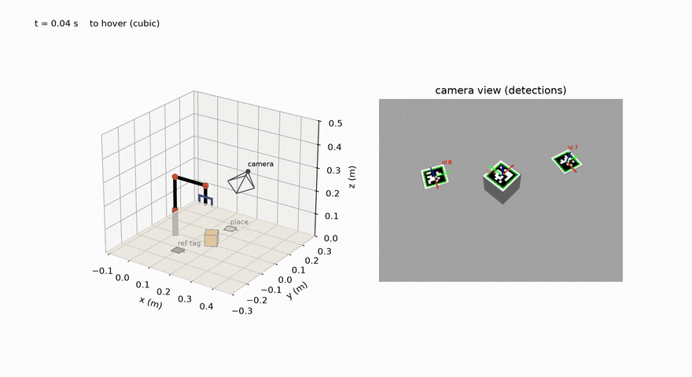

# AprilTag pick and place (simulated 5-DOF arm)

Term project for EEL-683 Introduction to Robotics, IIT Roorkee.
Aniruddh Yadav (23115014) and Harendra (23115048).

The idea: a camera looks at the table, finds an AprilTag stuck on an object, works out where the
object is in the robot's base frame, and the arm goes and picks it up and drops it on a second tag.
We did not get to the hardware, so everything here is simulation: a fake pinhole camera renders the
tags, the real OpenCV detector reads them back, and a 5 joint arm (base yaw, shoulder, elbow, wrist
pitch, wrist roll) is moved with our own forward/inverse kinematics and joint space trajectories.



Left: the arm, the cube with the tag on top, the reference tag (grey), the place tag (green) and the
camera. Right: what the camera sees, with the detected tags and their estimated axes drawn on.

## what is in here

| file | what it does |
|---|---|
| `arm.py` | DH table, forward kinematics, closed form inverse kinematics, geometric Jacobian, manipulability, one CLIK step |
| `trajectory.py` | cubic and quintic joint polynomials, multi segment planning |
| `camera.py` | pinhole camera model, renders AprilTags (and the cube) into a synthetic image |
| `tag_detect.py` | AprilTag detection (OpenCV aruco, 36h11), pose by PnP, ray/plane position, camera extrinsics from a reference tag |
| `transforms.py` | small helpers for 4x4 homogeneous transforms |
| `pick_place.py` | the full pipeline: perceive -> plan -> simulate -> plots / video |
| `viz.py` | matplotlib 3D drawing of the scene |
| `experiments/` | the scripts that made the plots in `results/` |
| `tests/test_arm.py` | FK / IK / Jacobian / trajectory sanity tests |
| `report/report.md` | the write up (`report.pdf` is the same thing) |
| `notes.md` | working notes, decisions, things that went wrong |

## running it

```
python -m venv .venv && source .venv/bin/activate
pip install -r requirements.txt
python pick_place.py                 # one scene, prints numbers, writes results/run_*.png
python pick_place.py --seed 3 --noise 10 --video --gif    # different scene, also writes the video
python tests/test_arm.py
python experiments/tag_pose_error.py # etc, each script writes its figure into results/
```

Python 3.10+ and OpenCV >= 4.7 (the aruco module with AprilTag refinement).

## main results

* FK from the DH table matches the hand derived planar formula to 1e-16 m. Closed form IK round trips to 1e-16 m,
  both elbow branches, about 45 us per call.
* Top down grasps are possible on the table for 5 cm < r < 30 cm from the base axis (workspace plot).
* CLIK position error decays as $e^{-Kt}$ exactly like the lecture derivation says, straight line approach tracks to < 0.03 mm.
* Tag pose: with AprilTag style corner refinement the object position in the base frame is good to about 0.7 mm
  (4 cm tag, 640x480 camera, 45 cm away). With the default sub pixel refinement it is 2-3 mm, with no refinement 4-7 mm.
* Image noise hardly matters. What matters is how well we know where the reference tag is: 5 mm / 2 deg of error
  on it gives 7 mm of object error and the grasp fails (Monte Carlo over 40 scenes per condition).
* The full run: object found 0.6 mm from its true position, placed 0.6 mm from the target, 9 s of motion.

Details, derivations and all the plots are in [report/report.md](report/report.md).
